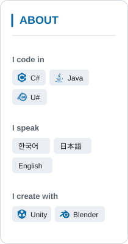

  <picture><source media="(prefers-color-scheme: dark)" srcset="assets/profile-about-dark-c6e3e65e06.svg" /><source media="(prefers-color-scheme: light)" srcset="assets/profile-about-light-53b6732f78.svg" /></picture>
  <picture>
    <source media="(prefers-color-scheme: dark)" srcset="assets/profile-workspace-dark-674586d186.svg" />
    <source media="(prefers-color-scheme: light)" srcset="assets/profile-workspace-light-43b9d04044.svg" />
    
  </picture>

## Projects

<strong>In Progress</strong> · 5

<table width="100%">
<thead><tr><th align="left" width="170">Project</th><th align="left" width="480">Overview</th><th align="left" width="150">Tech</th></tr></thead>
<tbody>
<tr>
  <td valign="top" width="170"><a href="https://github.com/hjcud/Shinjuku-Live-Street">Shinjuku-Live-Street</a></td>
  <td valign="top" width="480">VRChat street-performance world with shared live equipment and simulated traffic. <strong>Role:</strong> Gameplay programming and synchronization.</td>
  <td valign="top" width="150"><picture><source media="(prefers-color-scheme: dark)" srcset="assets/project-tech-unity-dark.svg"></picture> <picture><source media="(prefers-color-scheme: dark)" srcset="assets/project-tech-csharp-dark.svg"></picture> <picture><source media="(prefers-color-scheme: dark)" srcset="assets/project-tech-udonsharp-dark-786c19cce8.svg"></picture></td>
</tr>
<tr>
  <td valign="top" width="170"><a href="https://github.com/hjcud/yoiko_core">yoiko_core</a></td>
  <td valign="top" width="480">Cobblemon server mod with progression, trading, rewards, events, and turtle racing. <strong>Role:</strong> Solo development.</td>
  <td valign="top" width="150"><picture><source media="(prefers-color-scheme: dark)" srcset="assets/project-tech-java-dark.svg"></picture> <picture><source media="(prefers-color-scheme: dark)" srcset="assets/project-tech-neoforge-dark-5320b46ae6.svg"></picture></td>
</tr>
<tr>
  <td valign="top" width="170"><a href="https://github.com/hjcud/Pixerin">Pixel Mat</a></td>
  <td valign="top" width="480">Desktop pixel art editor for drawing by hand and making selection-scoped AI edits. <strong>Role:</strong> Solo development.</td>
  <td valign="top" width="150"><picture><source media="(prefers-color-scheme: dark)" srcset="assets/project-tech-electron-dark.svg"></picture> <picture><source media="(prefers-color-scheme: dark)" srcset="assets/project-tech-javascript-dark.svg"></picture></td>
</tr>
<tr>
  <td valign="top" width="170"><a href="https://github.com/project-miniworld/fantasy-sim">Miniworld</a> <picture><source media="(prefers-color-scheme: dark)" srcset="assets/project-tech-private-dark.svg"></picture></td>
  <td valign="top" width="480">2D fantasy world simulation with maps and simulated citizens. <strong>Role:</strong> Co-planning and development.</td>
  <td valign="top" width="150"><picture><source media="(prefers-color-scheme: dark)" srcset="assets/project-tech-unity-dark.svg"></picture> <picture><source media="(prefers-color-scheme: dark)" srcset="assets/project-tech-csharp-dark.svg"></picture></td>
</tr>
<tr>
  <td valign="top" width="170">바로 영업 <picture><source media="(prefers-color-scheme: dark)" srcset="assets/project-tech-private-dark.svg"></picture></td>
  <td valign="top" width="480">CRM for sales teams, with a web dashboard and an Android app. <strong>Role:</strong> App and web frontend development.</td>
  <td valign="top" width="150"><picture><source media="(prefers-color-scheme: dark)" srcset="assets/project-tech-spring-dark.svg"></picture> <picture><source media="(prefers-color-scheme: dark)" srcset="assets/project-tech-kotlin-dark.svg"></picture> <picture><source media="(prefers-color-scheme: dark)" srcset="assets/project-tech-typescript-dark.svg"></picture></td>
</tr>
</tbody>
</table>

<strong>On Hold</strong> · 1

<table width="100%">
<thead><tr><th align="left" width="170">Project</th><th align="left" width="480">Overview</th><th align="left" width="150">Tech</th></tr></thead>
<tbody>
<tr>
  <td valign="top" width="170"><a href="https://github.com/SmashAvatar/vrchat-project">Smash Avatar</a> <picture><source media="(prefers-color-scheme: dark)" srcset="assets/project-tech-private-dark.svg"></picture></td>
  <td valign="top" width="480">VRChat multiplayer project with custom movement, team management, and synchronized player UI. <strong>Role:</strong> Movement and behavior implementation.</td>
  <td valign="top" width="150"><picture><source media="(prefers-color-scheme: dark)" srcset="assets/project-tech-unity-dark.svg"></picture> <picture><source media="(prefers-color-scheme: dark)" srcset="assets/project-tech-csharp-dark.svg"></picture> <picture><source media="(prefers-color-scheme: dark)" srcset="assets/project-tech-udonsharp-dark-786c19cce8.svg"></picture></td>
</tr>
</tbody>
</table>

<strong>Completed</strong> · 6

<table width="100%">
<thead><tr><th align="left" width="170">Project</th><th align="left" width="480">Overview</th><th align="left" width="150">Tech</th></tr></thead>
<tbody>
<tr>
  <td valign="top" width="170"><a href="https://github.com/Idea2Strategy/Idea2Strategy">Idea2Strategy</a></td>
  <td valign="top" width="480">Platform for creating, backtesting, and running virtual trading strategies. <strong>Role:</strong> Frontend and backend development.</td>
  <td valign="top" width="150"><picture><source media="(prefers-color-scheme: dark)" srcset="assets/project-tech-spring-dark.svg"></picture> <picture><source media="(prefers-color-scheme: dark)" srcset="assets/project-tech-python-dark.svg"></picture> <picture><source media="(prefers-color-scheme: dark)" srcset="assets/project-tech-react-dark.svg"></picture></td>
</tr>
<tr>
  <td valign="top" width="170"><a href="https://github.com/kcrmin/Stackcord">Stackcord</a></td>
  <td valign="top" width="480">Codex collaboration tooling for shared project context, Git coordination, and release checks. <strong>Role:</strong> Collaborative workflow co-design.</td>
  <td valign="top" width="150"><picture><source media="(prefers-color-scheme: dark)" srcset="assets/project-tech-go-dark.svg"></picture> <picture><source media="(prefers-color-scheme: dark)" srcset="assets/project-tech-python-dark.svg"></picture></td>
</tr>
<tr>
  <td valign="top" width="170"><a href="https://github.com/hjcud/Shimanami-Ekranoplan">Shimanami-Ekranoplan</a></td>
  <td valign="top" width="480">Ekranoplan flight simulator with VR and desktop controls, built for interactive exhibitions. <strong>Role:</strong> Simulation programming.</td>
  <td valign="top" width="150"><picture><source media="(prefers-color-scheme: dark)" srcset="assets/project-tech-unity-dark.svg"></picture> <picture><source media="(prefers-color-scheme: dark)" srcset="assets/project-tech-csharp-dark.svg"></picture> <picture><source media="(prefers-color-scheme: dark)" srcset="assets/project-tech-udonsharp-dark-786c19cce8.svg"></picture></td>
</tr>
<tr>
  <td valign="top" width="170"><a href="https://github.com/hjcud/hinasaki-shaders">hinasaki-shaders</a></td>
  <td valign="top" width="480">Unity shaders for tears, refraction, pixelation, and holographic sights. <strong>Role:</strong> Commissioned shader development.</td>
  <td valign="top" width="150"><picture><source media="(prefers-color-scheme: dark)" srcset="assets/project-tech-unity-dark.svg"></picture> <picture><source media="(prefers-color-scheme: dark)" srcset="assets/project-tech-shaderlab-dark.svg"></picture> <picture><source media="(prefers-color-scheme: dark)" srcset="assets/project-tech-hlsl-dark.svg"></picture></td>
</tr>
<tr>
  <td valign="top" width="170"><a href="https://github.com/hjcud/yoiko_rank">yoiko_rank</a> <picture><source media="(prefers-color-scheme: dark)" srcset="assets/project-tech-private-dark.svg"></picture></td>
  <td valign="top" width="480">Minecraft server mod for player ranks, cosmetic badges, and daily rewards. <strong>Role:</strong> Solo development.</td>
  <td valign="top" width="150"><picture><source media="(prefers-color-scheme: dark)" srcset="assets/project-tech-java-dark.svg"></picture> <picture><source media="(prefers-color-scheme: dark)" srcset="assets/project-tech-neoforge-dark-5320b46ae6.svg"></picture></td>
</tr>
<tr>
  <td valign="top" width="170"><a href="https://github.com/hjcud/NeoForge-YoikoServerMod-1.21.1">NeoForge-YoikoServerMod-1.21.1</a> <picture><source media="(prefers-color-scheme: dark)" srcset="assets/project-tech-private-dark.svg"></picture></td>
  <td valign="top" width="480">Minecraft 1.21.1 server mod with custom mystery-gift items. <strong>Role:</strong> Solo development.</td>
  <td valign="top" width="150"><picture><source media="(prefers-color-scheme: dark)" srcset="assets/project-tech-java-dark.svg"></picture> <picture><source media="(prefers-color-scheme: dark)" srcset="assets/project-tech-neoforge-dark-5320b46ae6.svg"></picture></td>
</tr>
</tbody>
</table>

